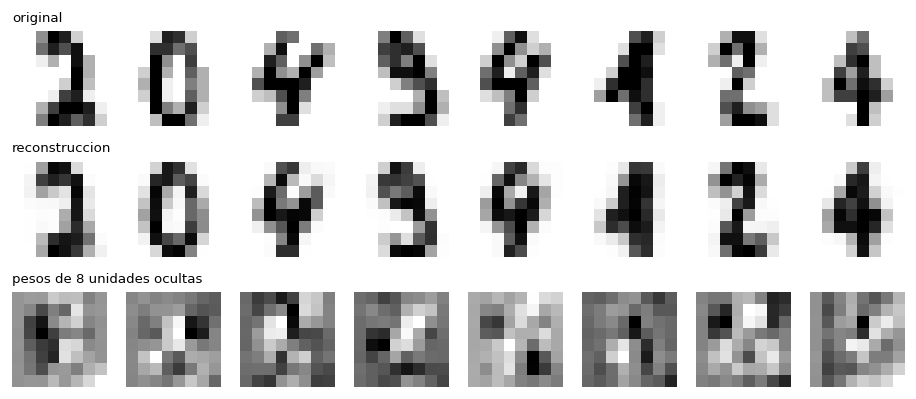

# RBM: máquina de Boltzmann restringida desde cero

Implementación de una **máquina de Boltzmann restringida (RBM)** Bernoulli-Bernoulli con `numpy`, entrenada con
**divergencia contrastiva (CD-k)**. Las RBM son redes generativas de dos capas que, a pesar de su simplicidad, sirven
para **reducción de dimensionalidad**: aprenden a describir los datos con menos variables (la capa oculta) y a reconstruirlos a partir de ellas.



*Arriba: dígitos de prueba. Centro: su reconstrucción pasando por 50 unidades ocultas. Abajo: los pesos de 8 de esas unidades.*

## Contenido

1. [Inicio rápido](#1-inicio-rápido)
2. [Estructura del proyecto](#2-estructura-del-proyecto)
3. [Cómo funciona una RBM](#3-cómo-funciona-una-rbm)
4. [Entrenamiento: divergencia contrastiva](#4-entrenamiento-divergencia-contrastiva)
5. [Uso desde código](#5-uso-desde-código)
6. [Pruebas](#6-pruebas)
7. [Resultados de referencia](#7-resultados-de-referencia)
8. [Limitaciones](#8-limitaciones)
9. [Material de referencia](#9-material-de-referencia)

---

## 1. Inicio rápido

Requisitos: Python 3.6 o superior. `numpy` basta para usar la RBM; `scikit-learn` y `matplotlib` son para los ejemplos.

```bash
pip install -r requirements.txt
python main.py                                  # reconstrucción de dígitos
python main.py --plot reconstruction.png        # además guarda una figura
python main.py --task classify                  # usa las características ocultas para clasificar
python -m unittest discover -s tests -t .       # pruebas
```

Opciones de `main.py`: `--task reconstruct|classify`, `--hidden 50`, `--epochs 100`, `--lr 0.1`, `--batch-size 32`,
`--k 1` (pasos de Gibbs), `--seed 0` y `--plot ARCHIVO`.

---

## 2. Estructura del proyecto

| Ruta | Contenido |
|---|---|
| `RBM.py` | La clase `RBM`: codificar, decodificar, energía libre, gradiente CD-k y entrenamiento. |
| `main.py` | Ejemplo por línea de comandos sobre los dígitos de sklearn (reconstrucción y clasificación). |
| `digits.ipynb` | Notebook paso a paso del mismo ejemplo, con sus gráficas. |
| `simple_image_dim_reduction.ipynb` | Reducción de dimensionalidad de una imagen con una RBM entrenada sobre parches. |
| `tests/` | Pruebas, incluida la comparación del gradiente con el exacto en una RBM diminuta. |
| `doc/articles/`, `doc/more/` | Documentación: artículos y apuntes sobre RBM en PDF. |
| `doc/code/` | Material de consulta: ejemplos de scikit-learn con `BernoulliRBM` (BSD), un notebook de PCA y el código de referencia de un curso (`basic/`). |

---

## 3. Cómo funciona una RBM

Una RBM tiene dos capas:

- La **capa visible** `v` son los datos (aquí, 64 píxeles con valores en [0, 1]).
- La **capa oculta** `h` son unidades binarias que aprenden características de los datos.

Los pesos `W` son una **única matriz compartida** por ambas capas y cada capa tiene su propio bias (`b_v` y `b_h`). Las neuronas **no se
conectan con otras de su misma capa**, solo con las de la otra capa. Esa restricción es lo que hace manejable la RBM.

### Energía y probabilidad

Cada configuración `(v, h)` tiene una **energía**; una energía baja significa que las dos capas son compatibles:

```
E(v, h) = - v · b_v  -  h · b_h  -  v · W · h
p(v, h) = exp(-E(v, h)) / Z               (Z es la suma de exp(-E) sobre todas las configuraciones)
```

Entrenar una RBM es **subir la probabilidad de los datos**, es decir, bajar la energía de las configuraciones que se parecen a ellos.

### Probabilidades condicionales

Gracias a la restricción de conexiones, las unidades de una capa son independientes entre sí dado el estado de la otra:

```
p(h_j = 1 | v) = sigmoide( v · W[:, j] + b_h[j] )
p(v_i = 1 | h) = sigmoide( W[i, :] · h + b_v[i] )
```

Con esto se codifica (`encode`: de visible a oculta) y se decodifica (`decode`: de oculta a visible). **Reconstruir** una imagen es
codificarla y decodificar el resultado. Si la capa oculta tiene menos unidades que la visible, esa representación oculta
es una versión comprimida de los datos.

### Energía libre

La energía libre de una imagen resume las configuraciones ocultas posibles:

```
F(v) = - log  suma_h exp(-E(v, h))  =  - v · b_v  -  suma_j log(1 + exp(v · W[:, j] + b_h[j]))
p(v) = exp(-F(v)) / Z
```

Una energía libre más baja significa que el modelo considera la imagen más probable. Se usa para vigilar el entrenamiento: si la energía libre
de los datos de prueba se separa de la de los de entrenamiento, hay sobreajuste.

---

## 4. Entrenamiento: divergencia contrastiva

Calcular el gradiente exacto de la log-verosimilitud exige conocer `Z`, que suma sobre todas las configuraciones y es inalcanzable
para redes de tamaño real. El gradiente tiene esta forma:

```
d log p(v) / dW  =  < v h >_datos  -  < v h >_modelo
```

El primer término (fase positiva) se calcula fácil con los datos. El segundo (fase negativa) requiere muestrear del modelo. La
**divergencia contrastiva CD-k** (Hinton, 2002) lo aproxima: en lugar de esperar a que una cadena de Gibbs llegue al equilibrio, la **inicia en un dato** y la
avanza solo `k` pasos:

```
v0 = datos          h0 ~ p(h | v0)
repetir k veces:    v ~ p(v | h)     h ~ p(h | v)
dW   = ( v0ᵀ p(h|v0)  -  vkᵀ p(h|vk) ) / n
db_v = media( v0 - vk )          db_h = media( p(h|v0) - p(h|vk) )
```

No es descenso del gradiente "puro" ni retropropagación, sino un **paso aproximado en la dirección del gradiente de la log-verosimilitud**. CD-1 está sesgado pero funciona bien en la práctica.

Detalles de la implementación (siguiendo la guía de Hinton, 2010):

- Las ocultas de las estadísticas usan **probabilidades** (menos ruido). La última reconstrucción visible también, salvo con `stochastic_negative=True`, que usa una muestra y evita ese sesgo adicional.
- El gradiente se **promedia** sobre el mini-lote, así que el learning rate no depende del tamaño del conjunto de datos.
- Pesos iniciales **pequeños** (desviación 0.01) para que las unidades no empiecen saturadas, y el bias visible se inicializa con la
  frecuencia media de cada píxel (`init_visible_bias=True`).
- La reconstrucción (`reconstruct`) es **determinista**: codifica con probabilidades, no con muestras.

---

## 5. Uso desde código

```python
from RBM import RBM

# X: matriz (n_instancias, n_visible) con valores en [0, 1]
rbm = RBM(n_visible=64, n_hidden=50, seed=0)
history = rbm.train(X_train, lr=0.1, epochs=100, batch_size=32, k=1, validation_data=X_test)

features = rbm.encode(X_test)        # (n, 50): reducción de dimensionalidad
restored = rbm.decode(features)      # (n, 64)
restored = rbm.reconstruct(X_test)   # lo mismo en un paso
error = rbm.reconstructionError(X_test)
energy = rbm.freeEnergy(X_test)      # una energía libre por imagen
```

| Método | Qué hace |
|---|---|
| `train(X, lr, epochs, batch_size, k, weight_decay, validation_data, init_visible_bias, verbose)` | Entrena con CD-k y devuelve el historial `{'reconstruction_error', 'free_energy'}` (más las versiones `val_` con datos de validación), un valor por época. |
| `encode(X, sample=False)` | Probabilidades de activación de las unidades ocultas, o una muestra binaria con `sample=True`. |
| `decode(H, sample=False)` | Reconstruye la capa visible a partir de una representación oculta. |
| `reconstruct(X)` | `decode(encode(X))`, determinista. |
| `reconstructionError(X)` | Error cuadrático medio de la reconstrucción. |
| `freeEnergy(V)` | Energía libre de cada fila. |
| `gradients(V0, k, stochastic_negative)` | Gradiente CD-k de un lote, sin aplicarlo. |

Los datos deben estar **escalados a [0, 1]**; `train` lo comprueba y falla con un mensaje claro si no es así.

---

## 6. Pruebas

```bash
python -m unittest discover -s tests -t .
```

Para una RBM diminuta (3 unidades visibles y 2 ocultas) se pueden enumerar las 32 configuraciones posibles, lo que permite
calcular `Z` y el gradiente exacto y comparar:

- La **energía libre** coincide con `-log Σ_h exp(-E)` y `p(v)` suma 1.
- El gradiente `<·>_datos − <·>_modelo` coincide con el **gradiente numérico** de la log-verosimilitud.
- **CD con una cadena larga** (30 pasos, muestras en la última visible) estima ese gradiente exacto con error menor a 0.03 (en la práctica ~0.007). CD-1
  apunta en una dirección parecida (coseno > 0.8) sin ser igual: es un gradiente aproximado. Con probabilidades en la última visible hay un sesgo pequeño con cadenas largas (~0.06), que es el motivo de `stochastic_negative`.
- Además: formas y rangos de `encode`/`decode`/`reconstruct`, reproducibilidad con semilla, inicialización del bias, caída de la energía libre al entrenar,
  que la RBM supere claramente a la imagen media en un problema de dos patrones con ruido, y que `weight_decay` reduzca la norma de los pesos.

---

## 7. Resultados de referencia

Dígitos de sklearn (1797 imágenes 8×8, píxeles divididos entre 16), 75 % / 25 % estratificado, 50 unidades ocultas, 100 épocas, CD-1.

### Reconstrucción (`python main.py --seed N`)

El error es el MSE en el conjunto de **prueba**; la referencia reconstruye toda imagen como la imagen media del entrenamiento.

| Semilla | Error de la RBM | Referencia (imagen media) |
|---|---|---|
| 0 | 0.0124 | 0.0740 |
| 1 | 0.0114 | 0.0724 |
| 2 | 0.0114 | 0.0732 |

La RBM reconstruye unas **seis veces mejor** que la imagen media, y la energía libre de entrenamiento y de prueba es casi igual (no hay sobreajuste).

### Clasificación con las características ocultas (`python main.py --task classify`)

Regresión logística sobre los 64 píxeles frente a las 50 características de la RBM:

| Semilla | 64 píxeles | 50 características |
|---|---|---|
| 0 | 0.9689 | 0.9689 |
| 1 | 0.9667 | 0.9689 |
| 2 | 0.9622 | 0.9622 |

Resultado equivalente: los dígitos ya son casi separables linealmente, así que no hay mejora que esperar. Lo que muestra es que **las 50 características conservan la información necesaria para clasificar**.

### Imagen (`simple_image_dim_reduction.ipynb`)

Una imagen de 160×200 se divide en 7469 parches solapados de 8×8. Con 32, 16 y 8 unidades ocultas por parche (50 %, 25 % y 12 % de los 64 valores) el MSE de la
imagen reconstruida es 0.0129, 0.0147 y 0.0164, frente a 0.072 de describir cada parche con el parche medio. Las reconstrucciones conservan
la estructura pero se ven desenfocadas. El experimento evalúa sobre la misma imagen que entrena, porque es una compresión de esa imagen.

### Qué se corrigió respecto a la primera versión

Con los mismos datos y escalados correctamente, la implementación anterior daba un error de prueba de 0.13 a 0.18, **peor** que la imagen media (0.073). El notebook, además,
dividía los píxeles entre 255 en lugar de entre 16, lo que dejaba los datos casi en cero y hacía que un error de 0.0004 pareciera excelente cuando era peor que
la referencia (0.0003). Otras causas: pesos iniciales con desviación 1, gradiente sumado en lugar de promediado (el paso dependía del tamaño del conjunto), sin mini-lotes,
y una pérdida calculada sobre muestras binarias con el estado anterior a la actualización.

---

## 8. Limitaciones

- Solo unidades **Bernoulli** (datos en [0, 1]); no hay unidades gaussianas para datos continuos sin escalar.
- Divergencia contrastiva simple (CD-k): no hay *persistent* CD, *momentum*, ni tasa de aprendizaje decreciente.
- Es una sola capa: no se apilan RBM (*deep belief networks*).
- No calcula la verosimilitud exacta (para redes de tamaño real `Z` es inalcanzable); se vigila con el error de reconstrucción y la energía libre.
- Código de numpy en CPU, pensado para entender el algoritmo.

---

## 9. Material de referencia

La carpeta `doc/` reúne la documentación consultada al estudiar las RBM:

- `doc/articles/` y `doc/more/`: artículos, apuntes de clase y un artículo de blog en PDF (Hinton, Larochelle, introducción a las RBM, campos aleatorios de Markov...).
- `doc/code/basic/`: notebook y código auxiliar de un curso de IBM sobre RBM y MNIST (`ML0120EN-4.1-Review-RBMMNIST.ipynb`, `utils.py`) y sus exportaciones.
- `doc/code/sklearn_Bernoulli/`: ejemplos de scikit-learn con `BernoulliRBM` (licencia BSD de scikit-learn), con su exportación HTML.
- `doc/code/pca/`: comparación con PCA sobre una imagen.

Estos materiales son de sus autores y se conservan aquí solo como apoyo de estudio; consulta cada fuente para sus condiciones de uso.

Referencias principales:

- G. E. Hinton, «Training products of experts by minimizing contrastive divergence», *Neural Computation* 14(8), 2002. Origen de CD.
- G. E. Hinton, «A Practical Guide to Training Restricted Boltzmann Machines», Univ. of Toronto, TR 2010-003. Detalles prácticos que sigue esta implementación.
- A. Fischer y C. Igel, «Training restricted Boltzmann machines: An introduction», *Pattern Recognition* 47(1), 2014.
- Documentación de scikit-learn sobre [`BernoulliRBM`](https://scikit-learn.org/stable/modules/generated/sklearn.neural_network.BernoulliRBM.html).

`simple_image_dim_reduction.ipynb` usa la imagen de ejemplo que incluye scikit-learn (consulta su documentación para la licencia de las imágenes).
